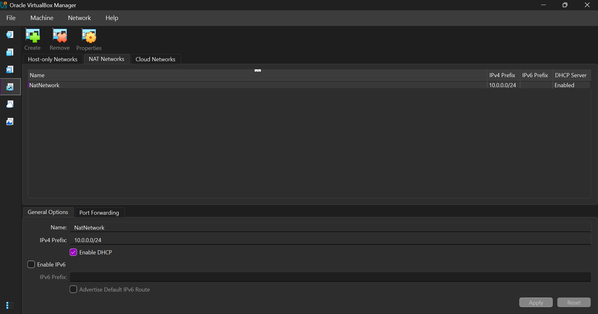
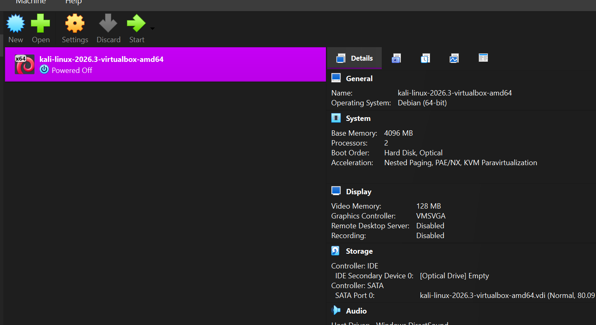
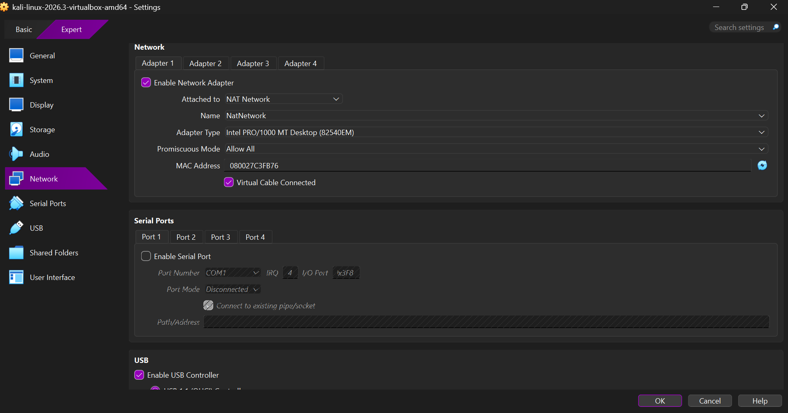
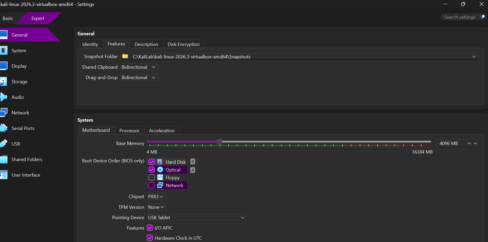
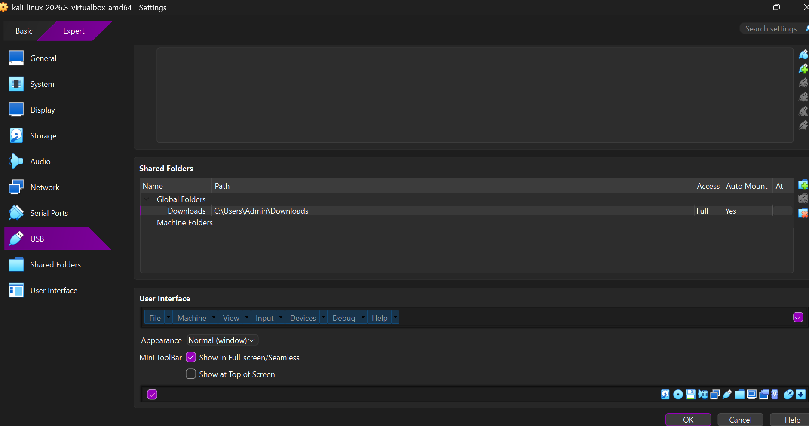
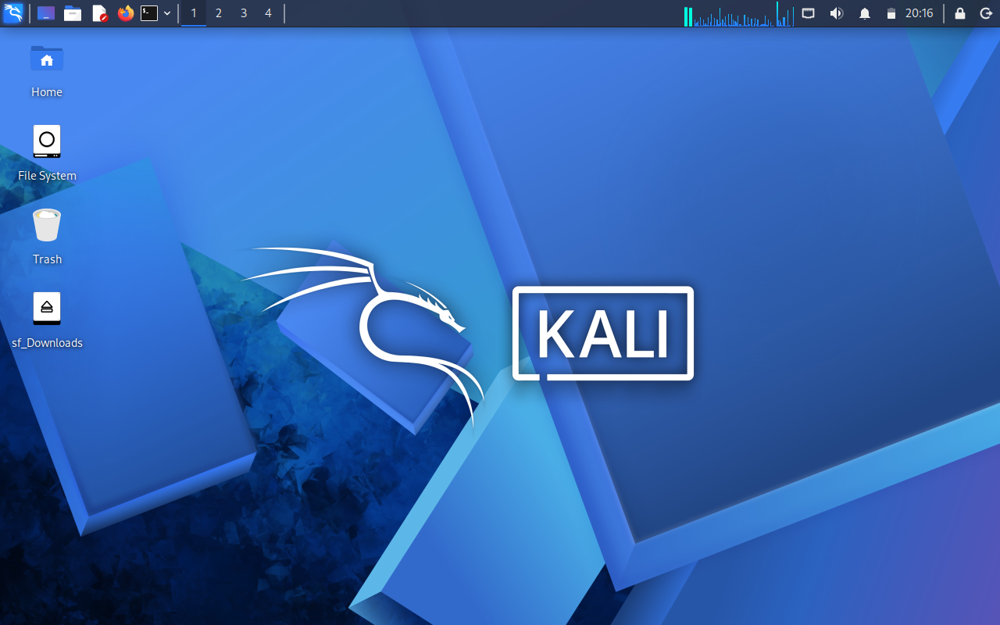
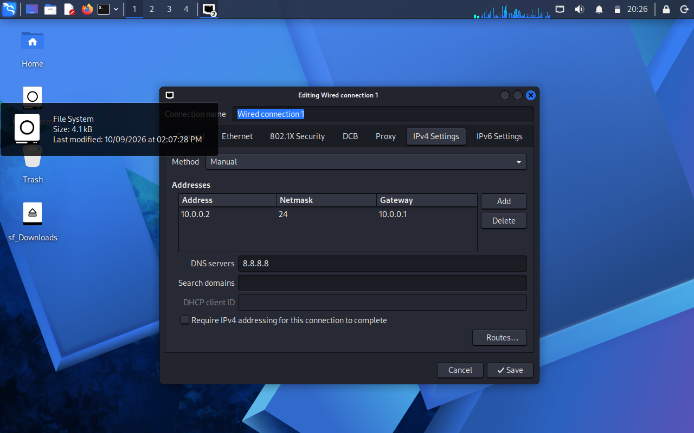
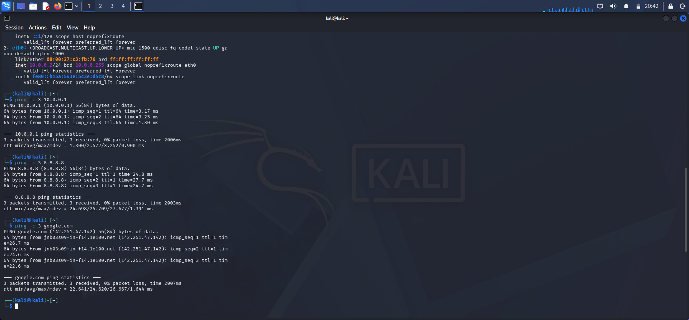
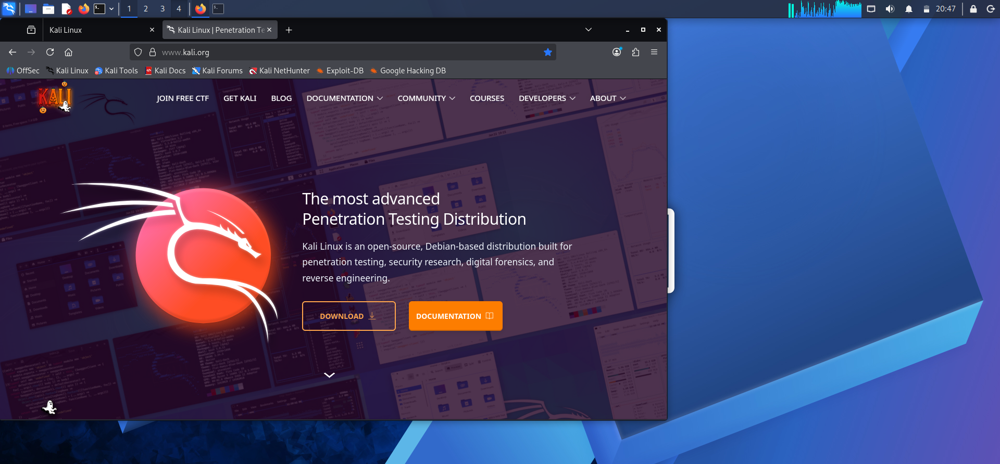
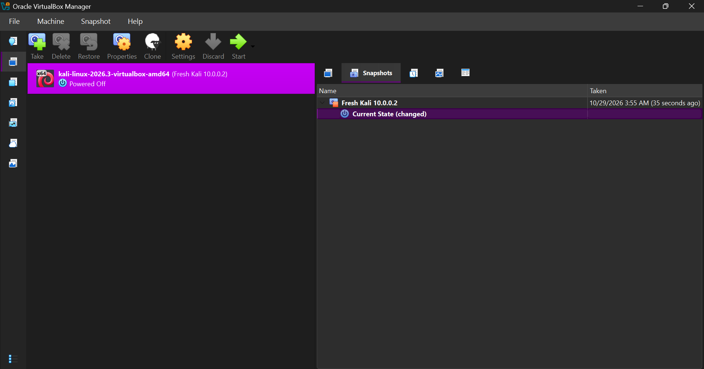

# NETWORKWALKS-MICHELLE-B084-WK1-PM1-CYBERSECURITY-LAB-SETUP

#  Cybersecurity Lab Environment Setup

Building an isolated virtual lab for penetration testing and ethical hacking practice.


---

##  Project Overview

This project sets up a virtual cybersecurity and penetration-testing laboratory using VirtualBox and Kali Linux.

The lab is a controlled environment where security tools, network scanning, and other testing activities can be practised safely and repeatedly. It runs on a private virtual network, so more machines can be added later and used as targets for authorized security testing.

>  **Ethical use:** Everything in this lab is done on my own laptop and my own virtual machines. Hacking is only legal on systems you own or have written permission to test.

---

##  Lab Environment

| Item | Details |
|------|---------|
| Host OS | Windows 11 |
| Virtualization | Oracle VirtualBox 7.2.22 |
| Attacker machine | Kali Linux 2026.3 (pre-built VirtualBox image) |
| Network type | NAT Network (custom) |
| Network name | NatNetwork |
| Subnet | 10.0.0.0/24 |
| Kali IP address | 10.0.0.2/24 |
| Gateway | 10.0.0.1 |
| DNS | 8.8.8.8 |
| Kali RAM / CPUs | 4096 MB / 2 |

---

##  Setup Steps

### Step 1: Install 7-Zip and VirtualBox
I installed 7-Zip to extract the Kali download, then installed the latest VirtualBox (7.2.22) from virtualbox.org.

### Step 2: Create the NAT Network
In VirtualBox, I went to **File > Tools > Network > NAT Networks** and created a network named `NatNetwork` with the prefix `10.0.0.0/24` and DHCP enabled.



### Step 3: Download and import Kali Linux
I downloaded the pre-built Kali Linux 2026.3 VirtualBox image from kali.org, extracted it with 7-Zip, and added the `.vbox` file to VirtualBox.



### Step 4: Configure the Kali VM network
In the VM settings, I attached **Adapter 1** to the **NAT Network** named `NatNetwork` and set **Promiscuous Mode** to **Allow All**. I also increased the memory to 4096 MB.



### Step 5: Enable clipboard and drag & drop
Under **General > Features**, I set **Shared Clipboard** and **Drag'n'Drop** to **Bidirectional**.



### Step 6: Add a shared folder
Under **Shared Folders**, I shared the Windows **Downloads** folder with Auto-mount and Make global enabled. It appears in Kali as `sf_Downloads`.



### Step 7: Start Kali Linux
Kali booted successfully and the shared folder is visible on the desktop.



### Step 8: Set the static IP address
In Kali, I opened **Edit Connections > Wired connection 1 > IPv4 Settings**, set the method to **Manual**, and entered:

- Address: `10.0.0.2`
- Netmask: `24`
- Gateway: `10.0.0.1`
- DNS: `8.8.8.8`



---

##  Verification

I confirmed the IP address and tested connectivity with these commands:

```
ip a
ping -c 3 10.0.0.1
ping -c 3 8.8.8.8
ping -c 3 google.com
```

All pings succeeded with 0% packet loss, and `eth0` shows `10.0.0.2/24`.



Firefox inside Kali also loads websites, which confirms full internet access.



---

##  Snapshot

After everything worked, I shut Kali down and took a snapshot named **Fresh Kali 10.0.0.2**, so I can always restore a clean working state.



---

##  Problems I Faced and How I Solved Them

### 1. Windows blocked the Kali download ("Virus detected")
**Problem:** Chrome blocked the Kali `.7z` file with a "Virus detected" warning. Kali is a security toolkit, so Windows often flags it as a false positive.
**Solution:** I downloaded the file from the official kali.org page into a dedicated folder (`C:\KaliLab`) and added only that folder as an exclusion in Windows Security. Windows protection stayed on for everything else.

### 2. Not enough disk space
**Problem:** The Kali image is about 3.6 GB to download and much bigger once extracted, and my C: drive was low on space.
**Solution:** I cleaned up temporary files and unneeded downloads with Windows Storage settings to free enough room first.

### 3. Wrong default NAT Network range
**Problem:** VirtualBox created the NAT Network as `10.0.2.0/24` by default, but the task needs `10.0.0.0/24`.
**Solution:** I changed the IPv4 prefix to `10.0.0.0/24` and clicked **Apply**.

### 4. "Network is unreachable" after setting the static IP
**Problem:** After saving the manual IP, `eth0` had no `10.0.0.2` address and pinging the gateway failed. This is a known issue with VirtualBox 7 and newer Kali versions.
**Solution:** I ran these commands, and the IP and internet worked right away:

```
sudo nmcli connection modify "Wired connection 1" ipv4.dad-timeout 0
sudo nmcli connection down "Wired connection 1"
sudo nmcli connection up "Wired connection 1"
```

---

##  What I Learned

- How to build an isolated virtual lab with VirtualBox
- How a NAT Network lets virtual machines talk to each other and reach the internet
- How to set a static IP address and fix connectivity problems with `nmcli`
- Why snapshots matter for safe, repeatable testing
- How to troubleshoot practical setup problems step by step

---

*Project for the Networkwalks Cybersecurity Program, Week 1 (WK1-PM1).*
